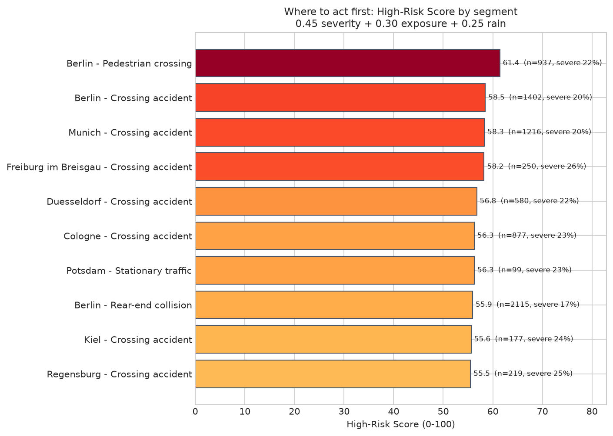
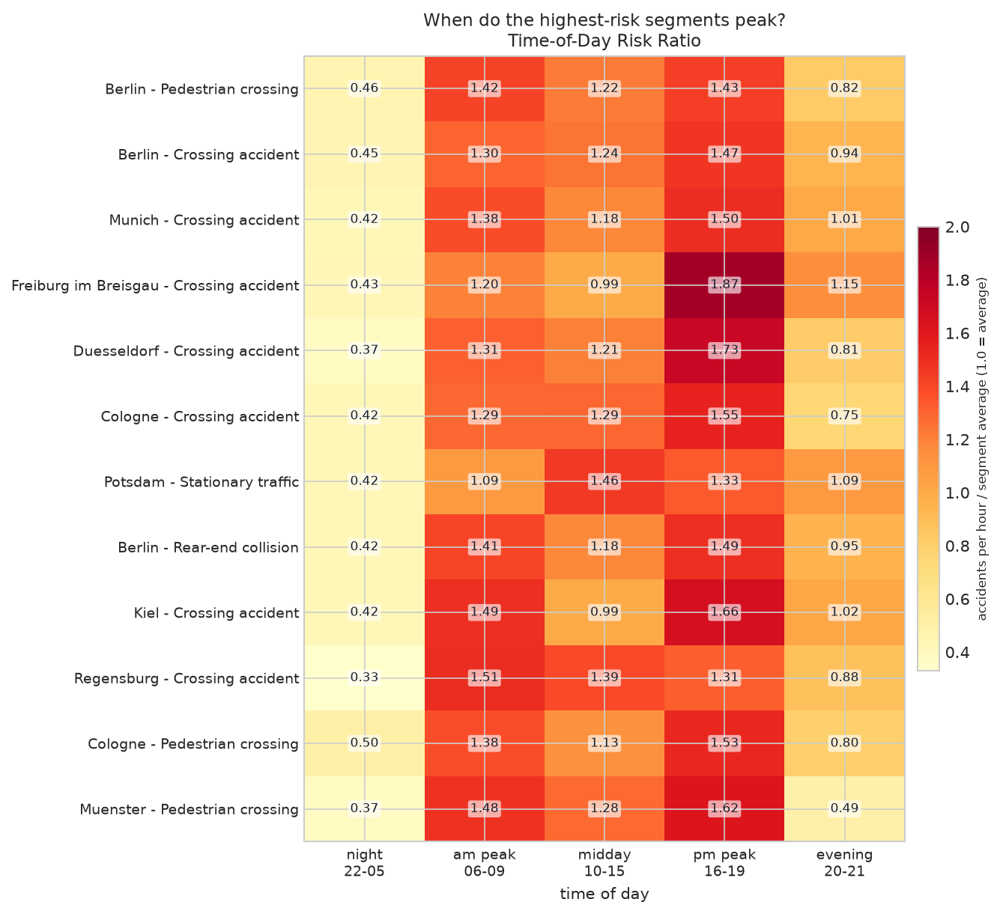
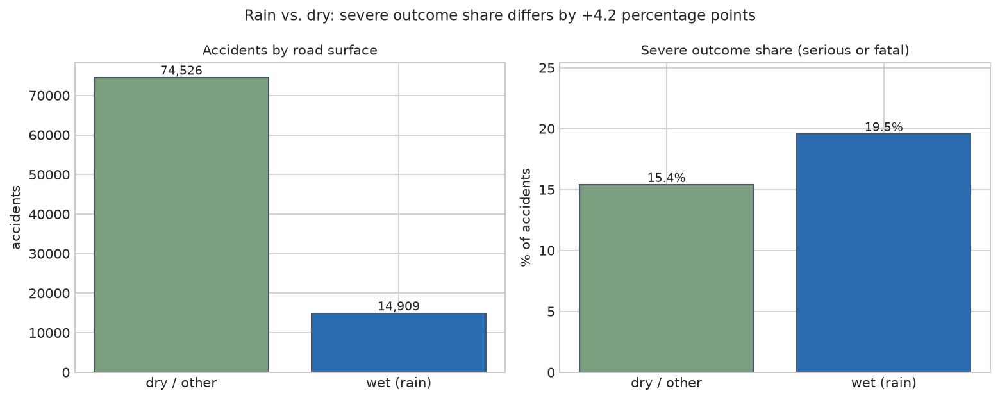

# Urban traffic accident risk analysis

A three-container data platform that turns a road-accident release into the three
answers a traffic planner actually needs: **where** to act, **when** it matters,
and **whether rain changes the outcome** - built end to end with Airflow, Postgres
and a GDPR-first data model.

This demo analyzes multi-source traffic data - including accident records,
road-segment traffic flow, time-of-day patterns, and weather conditions - to
identify high-risk road sections and time periods for traffic accidents, enabling
city traffic authorities to prioritize preventive measures such as signal timing
adjustments, speed-limit enforcement, or targeted patrols.

Dieses Demo analysiert multi-source Verkehrsdaten – einschließlich
Unfallaufzeichnungen, Verkehrsfluss pro Straßenabschnitt, tageszeitlichen Mustern
und Wetterbedingungen – um unfallgefährdete Straßenabschnitte und Zeitfenster zu
identifizieren, sodass die städtische Verkehrsbehörde präventive Maßnahmen wie
Ampelphasen-Optimierung, Geschwindigkeitskontrollen oder gezielte Streifen
priorisieren kann.



| Built with | Scope |
|---|---|
| Postgres 16, Airflow 3.4, Python 3.11 processing image, Docker Compose | 3 containers, 5-task DAG, 3 tables, 3 decision metrics, 3 charts |

The demo dataset is a deterministic, schema-accurate fixture (90,000 accidents,
26 districts, 7 accident types, 2019-2023). It contains PII-shaped columns on
purpose, so the anonymization step has something real to remove. Absolute numbers
are synthetic; the pipeline behaviour is not.

## The three decisions this pipeline supports

| # | Question | Metric | Answer in the demo run |
|---|---|---|---|
| 1 | Which segment should we fix first? | **High-Risk Score** (0-100) | `Berlin - Pedestrian crossing` - 61.4 with 937 accidents, 22% severe |
| 2 | When do these segments peak? | **Time-of-Day Risk Ratio** | Evening rush (16-19) is 1.3-1.9x each segment's average; nights are 0.33-0.50x |
| 3 | Does rain actually make accidents worse? | **Severity Ratio (wet vs dry)** | 19.5% severe when wet vs 15.4% dry - a **+4.2 pp** penalty |

## Architecture

```
Unfallatlas release / committed fixture
        │
        ▼
  airflow    ── 5-task DAG ────────────┐
  processing ── CLI, backfills, pytest ─┴─ identical mounts: ./src ./sql ./data ./outputs
        │
        ├──► postgres 16: raw.accidents_raw / clean.accidents / analytics.risk_metrics
        │
        └──► outputs/<date>/*.png + docs/img/*.png
```

| Container | Role | Why it exists separately |
|---|---|---|
| `postgres` | warehouse + Airflow metadata DB (`traffic`, `traffic_test`, `airflow`) | one server, three databases: the demo warehouse, a disposable test DB, and Airflow's own state |
| `airflow` | hosts the 5-task DAG | orchestration, retries, schedule, lineage of task XComs |
| `processing` | the same Python package without a scheduler | `pytest`, backfills and debugging without waiting for a DAG run |

Both app containers mount the same `src/`, `sql/`, `data/` and `outputs/` paths,
so a DAG task and a CLI command are literally the same function call.

## Quickstart

Requirements: Docker with Compose v2 and `make`. Nothing else - no local Python.

```bash
make env                      # creates .env with a Fernet key, JWT secret and pepper
make up                       # build + start postgres, airflow, processing
make run                      # run all five steps for 2024-03-01
make verify                   # GDPR + integrity report, exits non-zero on failure
make test                     # 90 tests, unit + integration
```

`make env` copies `.env.example` and replaces the three placeholder secrets; if you
prefer to do it by hand, `cp .env.example .env` and fill in `AIRFLOW_FERNET_KEY`,
`AIRFLOW_JWT_SECRET` and `PSEUDONYMIZATION_PEPPER` (an empty Fernet key makes the
Airflow container refuse to start).

Then:

* Airflow UI: <http://localhost:8080> (`admin` / the password from `.env`)
* Warehouse: `make psql`
* Charts: `outputs/2024-03-01/*.png` and `docs/img/*.png`

`make run LOGICAL_DATE=2024-06-01` processes another partition. `make help` lists
every target, including per-task runs (`make extract`, `make analyze`, ...).

### Airflow

```bash
docker compose exec -T airflow airflow dags list                            # urban_accident_risk
docker compose exec -T airflow airflow tasks test urban_accident_risk run_analysis 2024-03-01
```

The DAG runs monthly (`0 3 1 * *`, catchup off) with `max_active_runs=1`; each run
replaces its own logical-date partition, so re-running a month is safe. The whole
DAG runs end to end in about ten seconds on the fixture.

A one-hour Deadline Alert (`analysis_one_hour_sla`) demonstrates SLA-style alerting
(the Airflow 3 replacement for the removed task-level `sla=`). Known issue:
`airflow dags test` fails on 3.4.0 when a Deadline Alert is configured, so per-task
validation uses `airflow tasks test <dag> <task> <date>` instead - see ADR-011.

## What one run produces

`make run` executes five steps in order; every step is independently re-runnable
and returns a JSON summary (the DAG pushes the same dicts to XCom):

| Step | Summary from the demo run |
|---|---|
| 1. `extract` | 90,000 rows landed in `raw.accidents_raw`, 4 source columns dropped (`Halter`, `Name`, `Strasse`, `Unfallort_Freitext`), 13,473 rows carried a plate |
| 2. `anonymize` | 90,000 in -> 89,460 out: 505 duplicates, 413 invalid plates, 20 unusable timestamps, 15 unknown severities removed; 13,056 plate pseudonyms; 25 rows flagged `missing_hour`; retention sweep ran |
| 3. `load` | 89,460 rows upserted into `clean.accidents`, 13,473 raw plates redacted **in the same transaction**; a second run upserts the same keys (0 inserted, 89,460 already present) |
| 4. `analyze` | 182 segments x 6 rows = 1,092 metric rows from 89,435 accidents; 61.4 max High-Risk Score |
| 5. `visualize` | 3 charts as PNG + CSV into `outputs/2024-03-01/` and `docs/img/` |

Re-running the whole thing writes exactly the same rows (idempotency is tested,
not assumed).

## Data model

Three tables, one per zone - each with a retention window enforced by the schema:

| Table | Grain | Key columns | Retention |
|---|---|---|---|
| `raw.accidents_raw` | one row per source record | `payload` (allowlisted JSONB), `logical_date`, `plate_redacted_at` | 90 days |
| `clean.accidents` | one row per accident | `accident_key` (HMAC), `occurred_at`, `segment_key`, `plate_pseudonym`, `is_anonymized` | 10 years |
| `analytics.risk_metrics` | segment x time bucket | `high_risk_score`, `severity_ratio`, `rain_uplift`, `time_of_day_risk_ratio` | 10 years |

Constraints that do real work rather than decorate the DDL:

```sql
-- clean.accidents
CONSTRAINT clean_only_anonymized CHECK (is_anonymized),
CONSTRAINT clean_retention_policy CHECK (retention_until <= occurred_at::date + INTERVAL '10 years'),

-- raw.accidents_raw: storage limitation cannot be widened by configuration
CONSTRAINT raw_retention_policy CHECK (
    retention_until <= GREATEST(logical_date, (loaded_at AT TIME ZONE 'UTC')::date) + 120
)
```

Indexes are chosen for the three access patterns that actually exist: partition
replace and retention purges (`logical_date`, `retention_until`), the plate
redaction sweep (partial index `WHERE plate_redacted_at IS NULL`), and the
analytics reads (`(segment_key, hour_of_day)` plus partial indexes on the
`time_bucket = 'all'` and bucket rows).

## The five tasks

| Task | Input | Output | Idempotency mechanism |
|---|---|---|---|
| `extract` | release file or fixture | `raw.accidents_raw` | deletes the logical-date partition, then loads |
| `anonymize` | raw partition | `data/staging/<date>/clean_accidents.csv.gz` + quality counters | fully derived from raw, overwritten |
| `load` | staging CSV | `clean.accidents` | `INSERT ... ON CONFLICT (accident_key) DO UPDATE` |
| `analyze` | `clean.accidents` | `analytics.risk_metrics` | delete + insert in one transaction |
| `visualize` | `analytics.risk_metrics` | PNG + CSV | files overwritten |

The data itself never travels through XCom - only file paths and counters.

## The three metrics

### 1. High-Risk Score (0-100) - where to act first

```
score = 100 * (0.45 * severity_index + 0.30 * accident_density + 0.25 * rain_uplift)
```

Each component is min-max normalised across segments, so a busy-but-mild segment
cannot outrank a smaller, deadlier one on volume alone. The weights live in `.env`
(`RISK_WEIGHT_*`, validated to sum to 1.0) and the components are stored next to
the score, so a planner can see *why* a segment scored 61.4 and can re-weight
exposure without touching SQL.

### 2. Time-of-Day Risk Ratio - when it matters

```
ratio(segment, bucket) = (accidents in bucket / hours in bucket)
                       / (accidents in segment / 24)
```

`1.0` means "as expected for this segment". The heatmap answers "a crossing in
Berlin peaks at 16-19 with 1.43x its own average, but at night it is 0.46x" -
i.e. the same segment needs a different measure in the morning than at midnight.

### 3. Severity Ratio and rain uplift - does weather matter

```
severity_ratio = severe accidents (serious + fatal) / all accidents
rain_uplift    = severity_ratio(wet) / severity_ratio(dry)
```

In the demo: 19.5% vs 15.4% -> uplift 1.27. This is the sanity check for the rain
weight in the composite score: if the uplift were ~1.0, the 0.25 weight would be
unjustified and visible as such.

## The three charts

Each chart ships as PNG *and* as the CSV it was drawn from (`outputs/<date>/`),
so a number in a screenshot can always be traced back to a query result.

**1. When do the highest-risk segments peak?** - Time-of-Day Risk Ratio heatmap
for the top segments (rows sorted by High-Risk Score, `TOP_SEGMENTS_HEATMAP`).
Answers: *this crossing needs a morning measure, that one a 16-19 measure.*



**2. Where to act first?** - Ranked High-Risk Score, annotated with `n` and the
severe share, so the reader can tell whether the score comes from volume or from
severity.


**3. Does rain matter?** - Accidents by road surface next to the severe-outcome
share. This is the falsification test for the 0.25 rain weight.



## GDPR and privacy design

The source data is published anonymous, yet the pipeline is built as if it were
not - that is the point of the exercise:

* **Allowlist, not denylist.** `extract` projects 18 named fields and reports every
  dropped column; a new field in a future release is ignored by default.
* **Keyed pseudonyms.** `accident_key` and `plate_pseudonym` are
  `HMAC-SHA256(PSEUDONYMIZATION_PEPPER, ...)`. A plain SHA-256 of a German plate
  (space ~10^7) is brute-forceable in minutes; the pepper is the difference
  between tokenization and a lookup table.
* **The plate exists for one transaction.** `load` deletes `payload->'plate_raw'`
  in the same transaction that inserts the clean row, and records
  `plate_redacted_at` as proof.
* **Storage limitation in the schema.** `CHECK` constraints cap the raw window at
  120 days and the pseudonymized window at 10 years; `sql/03_retention.sql` purges.
* **A row cannot be published unanonymized**: `CHECK (is_anonymized)` in
  `clean.accidents`, verified again by the staging reader and by `make verify`.
* **Small groups are suppressed**: segments with fewer than `MIN_SEGMENT_ACCIDENTS`
  (default 20) accidents never reach the analytics layer.
* **Least privilege**: `traffic_analyst` has `USAGE` on `clean` and `analytics`
  only - the raw zone is invisible to reporting roles.

Full reasoning, threat model and residual risks: [`docs/data_governance.md`](docs/data_governance.md).

```bash
$ make verify
{
  "checks": {"analytics_layer_has_rows": true, "clean_layer_has_rows": true,
             "clean_retention_respected": true, "no_pii_named_columns": true,
             "no_plates_left_in_raw": true, "no_unanonymized_rows": true,
             "raw_retention_respected": true},
  "counts": {"clean_past_retention": 0, "clean_rows": 89460, "metric_rows": 1092,
             "not_anonymized": 0, "raw_past_retention": 0,
             "raw_plates_remaining": 0, "raw_rows": 90000},
  "passed": true,
  "pii_named_columns": {}
}
```

## Testing

```bash
make test                 # all 90 tests
make test-unit            # 72 tests, no database needed
make test-integration     # 18 tests against the traffic_test database
```

DAG validation lives outside pytest: because the Deadline Alert makes
`airflow dags test` fail on Airflow 3.4.0, per-task DAG checks use
`airflow tasks test <dag> <task> <date>` instead (see the Airflow section above
and ADR-011).

| File | Tests | What it pins down |
|---|---|---|
| `test_constants.py` | 18 | hour->bucket mapping, severity inversion, risk weights, denylist escape hatches |
| `test_extract.py` | 9 | allowlist projection, PII columns dropped, source resolution errors |
| `test_anonymize.py` | 30 | plate normalization, HMAC determinism, participant mix, every cleaning rule and its counter |
| `test_metrics.py` | 15 | metric definitions, parameter binding, SQL placeholders, weight drift |
| `test_pipeline.py` | 18 | the real 5-step run against Postgres: partition replace, PII absence, idempotency, CHECK constraints, governance report |

Integration tests build their schemas from the shipped `sql/` files into
`traffic_test`, never into the demo warehouse, and skip with a clear message when
PostgreSQL is unreachable - so `make test-unit` is usable offline.

Both app containers install the same `requirements/processing.txt`, but the
Airflow image resolves it under Airflow's constraint file, so the versions are
only *aligned*, not identical:

```bash
$ make versions
processing: python 3.11.18 | pandas 3.1.1 | numpy 2.4.6 | matplotlib 3.11.2
airflow:    python 3.11.18 | pandas 3.1.0 | numpy 2.4.6 | matplotlib 3.11.2
```

That target exists because drift is otherwise silent: a container keeps running
the image it was started from, so after `make build` a `docker compose restart`
(or `make restart`) is needed before the new libraries are actually in use.

## Design decisions

Ten short records in [`docs/decisions.md`](docs/decisions.md): why HMAC instead of
a hash, why the raw zone is allowlisted, why five tasks instead of one, why the
staging artifact is a file, why analytics is a full refresh, why retention is
anchored on arrival (this one was found by the first end-to-end run), the grain of
a "segment", the score weights, the single-container Airflow, and the fixture.

## Limitations and what I would do next

* **Synthetic data.** Absolute numbers are meaningless; only behaviour is tested.
* **Airflow runs all components in one container.** Production wants scheduler,
  API server, dag processor and workers as separate services; the compose change is
  small because both containers already share `/src`.
* **No streaming.** Ingestion is batch-per-release; a real feed would land files
  and trigger on arrival instead of a monthly cron.
* **Segment grain is district x type.** Street-level hot spots need a different
  (and more privacy-sensitive) geometry, which would require a DPIA update.
* **Score weights are judgement, not regression.** Given labelled outcomes
  (e.g. hospital data), the weights could be fit instead of configured.

## Data source and attribution

* Source: **Unfallatlas** - accident data with personal injury, published by the
  statistical offices of the German federal states, via
  <https://unfallatlas.statistikportal.de/>.
* Licence: **Datenlizenz Deutschland - Namensnennung 2.0 (DL-DE-BY-2.0)**. The
  attribution above must be kept when the data or derived charts are published.
* This repository contains **no real accident records**. `data/sample/` holds a
  generated fixture (`tools/make_fixture.py`, seeded) that mirrors the source
  schema, including the PII-shaped columns the pipeline is designed to remove.

## Repository layout

```
airflow/dags/urban_accident_risk_dag.py   5 TaskFlow tasks, one per step
docker/{airflow,processing}/Dockerfile    the two app images
sql/01_schema.sql                         raw / clean / analytics + CHECK constraints
sql/02_indexes.sql                        indexes for purges and analytics reads
sql/03_retention.sql                      parameter-free purge, runnable by an auditor
sql/04_roles.sql                          least-privilege group roles
src/accident_risk/
    config.py        env -> Settings, validated (windows, weights, pepper)
    extract.py       release -> allowlisted JSONB, partition replace
    anonymize.py     cleaning rules + HMAC pseudonyms -> staging artifact
    load.py          staging -> clean.accidents (upsert, plate redaction)
    metrics.py       the three decision metrics as one SQL pass
    viz.py           three charts, PNG + CSV
    db.py            psycopg helpers, SQL splitter, retention sweep
    cli.py           extract|anonymize|load|analyze|visualize|run|verify
tests/                                    90 tests (72 unit, 18 integration)
tools/make_fixture.py                     deterministic fixture generator
outputs/<date>/                           generated charts (git-ignored)
```
